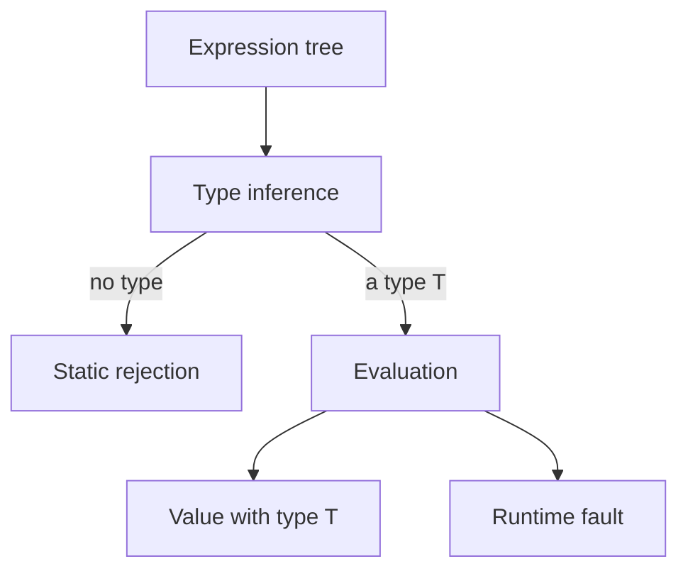

# A deliberately small core language

This is a **teaching model**, named `PlatoCore` in [Core.lean](Core.lean). It captures the shape of integer literals, Boolean literals, integer addition, conditionals, and typed runtime faults. It is not another normative definition of Plato. Consult [SEMANTICS](../../SEMANTICS.md) and [evaluation](../language/evaluation.md) for the source language and implementation evidence.

## Syntax and notation

`e`, `a`, `b`, and `c` denote expressions. `n` is a mathematical integer, `q` is `true` or `false`, and `T` denotes a type. A grammar describes which expression trees exist:

```text
T ::= Integer | Boolean

e ::= integer(n)
    | boolean(q)
    | add(e, e)
    | cond(e, e, e)
    | fault(T)
```

The actual Lean constructors are `Ty.integer`, `Ty.boolean`, `Expr.integer`, `Expr.boolean`, `Expr.add`, `Expr.cond`, and `Expr.fault`. A constructor names a distinct tree shape. For example, `Expr.integer 1` is syntax for an integer expression; it is not yet its evaluated result.

`cond(c, a, b)` corresponds to the shape of Plato's `c ? a : b`. Only the branch selected by the Boolean guard runs. `fault(T)` represents a computation that fails when evaluated and is statically assigned type `T`. It is **not** a source-level `throw` feature, nor a proof that arbitrary Plato faults can be ascribed any type.

## Values and outcomes

A value is either an integer or a Boolean. Evaluation returns an outcome:

| Outcome | Meaning |
|---|---|
| `value(v)` | Evaluation produced a value `v`. |
| `fault` | Evaluation reached a modeled runtime failure. |
| `typeError` | Evaluation encountered the wrong kind of value for an operation. |

The distinction lets us state something meaningful: a well-typed expression can fault, but cannot produce a runtime `typeError`. For example, adding an integer and a Boolean is a syntax tree in this model, but typing rejects it.



The diagram assumes the proved connection between inference and typing; evaluation itself also accepts untyped trees and can report `typeError` on them.

## Essential exclusions

There are no variables, binding environments, functions, recursion, loops, arrays, records, sums, interfaces, generics, conversions, overload resolution, affine builders, or floating-point operations. Every expression is a finite tree and every recursive evaluator call visits a strict subtree. Lean checks termination of the evaluator definition. There is no divergence outcome because this core cannot express divergence.

The integers are Lean `Int`: unbounded mathematical integers. Plato's numeric profiles use machine integers with runtime behavior specified elsewhere. Consequently these proofs say nothing about overflow, checked conversion, or profile equivalence. A real arithmetic model must choose those behaviors explicitly.

## Related work

[Software Foundations' typed arithmetic](https://softwarefoundations.cis.upenn.edu/plf-current/Types.html) similarly makes ill-typed syntax representable so that safety is a substantive theorem. Its arithmetic uses natural-number constructors; this core instead has signed integer literals and addition. Neither model by itself establishes the behavior of a production language implementation.
