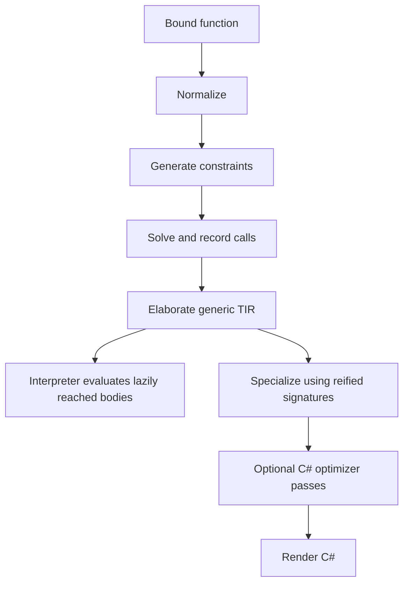

# Typed IR, specialization, and execution

The typed intermediate representation (TIR) records decisions that each writer must not guess again: expression types, the selected function, instantiated parameter and result types, argument conversions, and source origins. The model is defined in [Tir.cs](../../../src/Plato.Compiler/Checking/Tir.cs). [Elaborator](../../../src/Plato.Compiler/Checking/Elaborator.cs) constructs it from solver results.

A conversion the solver selected is part of the node. The elaborator must not drop it and hope the host inserts the same one. An unresolved call stays visible to diagnostics.

## Node vocabulary

| Nodes | Role |
|---|---|
| `TirLiteral`, `TirParameter`, `TirVariable` | Literal values and references to binding identities |
| `TirTypeRef`, `TirDefault`, `TirName` | Type tokens, contextual defaults, and residual bare-name handling |
| `TirCall` | Named function application with selected callee and emission classification |
| `TirCoerce` | Explicit record of a previously implicit conversion |
| `TirInvoke`, `TirLambda` | Function-value invocation and closure-producing lambda |
| `TirConditional`, `TirArray`, `TirNew` | Branching and value construction |
| `TirLet`, `TirAssign` | Local binding and rebinding |
| `TirBlock`, `TirReturn`, `TirIf`, `TirLoop` | Sequenced control flow |
| `TirUnresolved` | Explicit failure residue, not an executable verified expression |

Every value-producing node should carry a solved type and a source origin. A pure statement node need not have a value type. Nodes expose children and rebuild operations, so a generic transformation can walk and rewrite the tree without discarding metadata.

## Elaborating a call

For a solver-committed call, copy the callee, the instantiated signature, and the argument match kinds. Wrap an argument that requires conversion in `TirCoerce`. Do not rely on C# to infer an implicit operator. The host operator can differ from the one the solver chose. Classify emission as constructor, field or accessor, operator, conversion, intrinsic, or method or static form. These classifications describe rendering. They are not separate source dispatch rules.

The implementation retains syntactic calls with null callees for some known runtime operations and for lowered sum tests and projections. "All calls are resolved" is an intended strong invariant for an ideal core. It is not a literal claim about every node the existing writer accepts. `TirUnresolved` and syntactic fallback must remain visible to diagnostics and verification.

Boolean short-circuit operators become conditionals. Match becomes a conditional chain over case tags, and payload binders are replaced by projections. Match has no dedicated TIR node. [The evaluation caveat](../language/evaluation.md) explains the consequence for a nontrivial subject.

## Specialization

[Monomorphizer](../../../src/Plato.Compiler/Checking/Monomorphizer.cs) elaborates original bodies, then pairs generic signatures with concrete reified signatures. The substitution must cover both original and solver-zonked variables, and `Self`. It substitutes every node type and redispatches an abstract interface call against the concrete receiver. A residual-grounding step can use expected return shapes and implemented interface instances to fill variables that direct signature pairing did not reach.

A suitable worklist key is the original function identity plus the concrete type arguments and the receiver identity. Reuse an already-created specialization. Do not recursively stamp duplicates. The existing implementation uses the compilation's reification machinery as its instantiation authority. A generic output surface may remain generic where the writer requests an open generic body.

## Interpreter model

[Interpreter](../../../src/Plato.Interpreter/Evaluation/Interpreter.cs) checks and elaborates a reached function on first use, then caches its TIR. It executes generic bodies without first generating C#. [Dispatch](../../../src/Plato.Interpreter/Evaluation/Dispatch.cs) chooses concrete implementations for calls whose receiver is still abstract in the generic body.

Values have explicit interpreter representations for records, sums, arrays, type tokens, and closures. They are not arbitrary C# domain objects. Environments retain parameter and local definition identities. Call arguments and array elements are evaluated in order. A return propagates out of a block or a loop through control information. It does not become an ordinary value that a later statement consumes.

Unknown nodes, unresolved expressions, unavailable intrinsics, exceeded limits, and invalid operations produce evaluation faults. Host intrinsic dispatch is a trusted boundary. Its numeric profile, eager collection contracts, and builder invalidation behavior must agree with the source semantics.

## Invariants

[TirTypeVerifier](../../../src/Plato.Compiler/Checking/TirTypeVerifier.cs) checks several expression-level invariants and distinguishes residual `Self` and type parameters from hard failures. It is executable validation. It is not a proof that every accepted source program cannot get stuck. A formal compiler-correctness statement would relate source evaluation, elaborated evaluation, specialized evaluation, and host execution under explicit runtime assumptions. See [formal work](../formal/README.md).

The [C# expression specification](https://learn.microsoft.com/en-us/dotnet/csharp/language-reference/language-specification/expressions) is useful when checking that a printed typed node preserves order and conversions. Syntactically valid C# is a weaker property than preserving Plato behavior.
