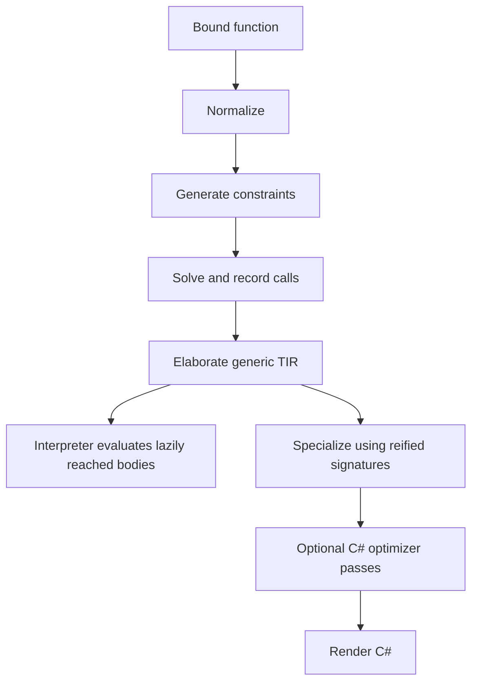

# Typed IR, specialization, and execution

The **typed intermediate representation** (TIR) records decisions that should not be guessed again by each writer: expression types, the selected function, instantiated parameter/result types, argument conversions, and source origins. The model is defined in [Tir.cs](../../../src/Plato.Compiler/Checking/Tir.cs); [Elaborator](../../../src/Plato.Compiler/Checking/Elaborator.cs) constructs it from solver results.

## Node vocabulary

| Nodes | Role |
|---|---|
| `TirLiteral`, `TirParameter`, `TirVariable` | Literal values and references to binding identities |
| `TirTypeRef`, `TirDefault`, `TirName` | Type tokens, contextual defaults, and residual bare-name handling |
| `TirCall` | Named function application with selected callee and emission classification |
| `TirCoerce` | Explicit record of a previously implicit conversion |
| `TirInvoke`, `TirLambda` | Function-value invocation and closure-producing lambda |
| `TirConditional`, `TirArray`, `TirNew` | Branching and value construction |
| `TirLet`, `TirAssign` | Local binding and rebinding |
| `TirBlock`, `TirReturn`, `TirIf`, `TirLoop` | Sequenced control flow |
| `TirUnresolved` | Explicit failure residue, not an executable verified expression |

Every value-producing node should carry a solved type and source origin. Pure statement nodes need not have a value type. Nodes expose children and rebuild operations so generic transformations can traverse and rewrite the tree without discarding metadata.

## Elaborating a call

For a solver-committed call, copy the callee, instantiated signature, and argument match kinds. Wrap arguments requiring conversion in `TirCoerce`; do not rely on C# to infer a possibly different implicit operator. Classify emission as constructor, field/accessor, operator, conversion, intrinsic, or method/static form. These classifications describe rendering, not separate source dispatch rules.

The implementation retains syntactic calls with null callees for some known runtime operations and lowered sum tests/projections. Therefore “all calls are resolved” is an intended strong invariant for an ideal core, not a literal claim about every node accepted by the existing writer. `TirUnresolved` and syntactic fallback must remain visible to diagnostics and verification.

Boolean short-circuit operators become conditionals. Match becomes a conditional chain over case tags, with payload binders replaced by projections. The match has no dedicated TIR node; [the evaluation caveat](../language/evaluation.md) explains the consequence for a nontrivial subject.

## Specialization

[Monomorphizer](../../../src/Plato.Compiler/Checking/Monomorphizer.cs) elaborates original bodies, then pairs generic signatures with concrete reified signatures. The substitution must cover both original and solver-zonked variables and `Self`. It substitutes every node type and redispatches abstract interface calls against the concrete receiver. A residual-grounding step can use expected return shapes and implemented interface instances to fill variables not reached by direct signature pairing.

A suitable worklist key is original function identity plus concrete type arguments/receiver identity. Reuse an already-created specialization rather than recursively stamping duplicates. The existing implementation uses the compilation's reification machinery as its instantiation authority. Generic output surfaces may remain generic where the writer requests an open generic body.

## Interpreter model

[Interpreter](../../../src/Plato.Interpreter/Evaluation/Interpreter.cs) checks/elaborates a reached function on first use and caches its TIR. It executes generic bodies without first generating C#. [Dispatch](../../../src/Plato.Interpreter/Evaluation/Dispatch.cs) chooses concrete implementations for calls whose receiver remains abstract in the generic body.

Values have explicit interpreter representations for records, sums, arrays, type tokens, and closures; they are not arbitrary C# domain objects. Environments retain parameter/local definition identities. Call arguments and array elements are evaluated in order. Returns propagate out of blocks and loops using control information rather than becoming ordinary values that later statements consume.

Unknown nodes, unresolved expressions, unavailable intrinsics, exceeded limits, and invalid operations produce evaluation faults. Host intrinsic dispatch is a trusted boundary: its numeric profile, eager collection contracts, and builder invalidation behavior must agree with the source semantics.

## Invariants and related work

[TirTypeVerifier](../../../src/Plato.Compiler/Checking/TirTypeVerifier.cs) checks several expression-level invariants and distinguishes residual `Self`/type parameters from hard failures. It is executable validation, not a proof that every accepted source program cannot get stuck. A formal compiler-correctness statement would relate source evaluation, elaborated evaluation, specialized evaluation, and host execution under explicit runtime assumptions. See [formal work](../formal/README.md).

The [C# expression specification](https://learn.microsoft.com/en-us/dotnet/csharp/language-reference/language-specification/expressions) is useful when checking that printing a typed node preserves order and conversions. Merely obtaining syntactically valid C# is a weaker property than preserving Plato behavior.
