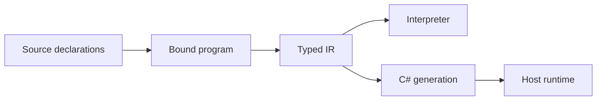

# Programs, values, and names

A compilation combines selected `.plato` files into one program. All top-level declarations share a global scope. File and library names organize source; they do not create namespaces. There are no source imports. Include every dependency explicitly in the input roots. Declaration order is intended to be irrelevant to ordinary name resolution.

The CLI enumerates each input root's immediate `.plato` files. Naming a parent directory does not automatically compile its nested tier folders. This matters when a small example uses `Number`, arrays, tuples, or interfaces: their declarations must be present.

## Three declaration families

```plato
type Sample { Time: Number; Value: Number; }
interface IMeasured { Magnitude(x: Self): Number; }
library Samples { ValueAt(s: Sample): Number => s.Value; }
```

A `type` declares data, as a product of fields or a [sum of alternatives](sums.md). A `primitive` declaration marks data whose representation the runtime supplies. An `interface` (`concept` is an alias) declares function requirements. A `library` contains functions. Library names do not qualify calls: two libraries declaring `ValueAt` contribute to the same overload group.

Typing is predominantly **nominal**: two products with the same fields still have different identities. An expected product may accept a same-shape tuple; this is the explicit structural construction exception, not general structural subtyping.

## Purity and partiality

Ordinary Plato values are immutable. Updating a record means returning a new value. There is no source-level I/O, null, reflection, or ordinary mutable object graph. [Locals and intrinsic builders](state-and-builders.md) support imperative algorithms without making shared mutable values the public model.

Purity means no observable mutation of shared program state. It does **not** mean every computation succeeds, terminates, or behaves like exact real arithmetic. Division, indexing, host obligations, and finite resources can fault. Floating arithmetic rounds. A loop or recursive function may diverge.



The interpreter evaluates generic bodies and dispatches an interface call using actual receiver types. The C# path specializes typed bodies where required. These are different implementations intended to preserve the same language behavior; agreement is tested, not assumed as a theorem.

## Evidence and authority

The rules above are specified in [SEMANTICS](../../SEMANTICS.md). Input handling lives in [the CLI](../../../src/Plato.CLI/Program.cs); global declaration binding lives in [Compilation](../../../src/Plato.Compiler/Compilation.cs). The execution split is visible in [Interpreter](../../../src/Plato.Interpreter/Evaluation/Interpreter.cs) and [Monomorphizer](../../../src/Plato.Compiler/Checking/Monomorphizer.cs).

## Related work

[Haskell's report](https://www.haskell.org/onlinereport/intro.html) also puts typed expressions and pure functions at the center. Plato differs through eager evaluation, nominal records, receiver syntax, and target-runtime arithmetic. C# is the operational target used as evidence here, but C# namespaces, classes, nulls, and exceptions do not automatically become Plato features.
