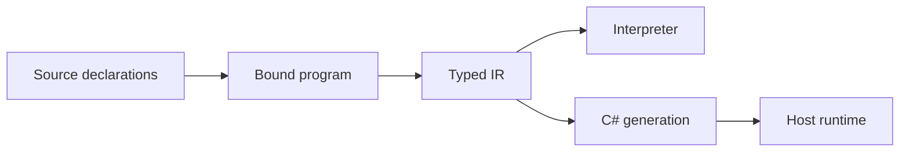

# Programs, values, and names

A compilation is one program built from the selected `.plato` files. Every top-level
declaration shares that global scope. File names and library names organize source.
They do not create namespaces. Plato has no source imports. Include every
dependency explicitly in the input roots. Declaration order is intended to be
irrelevant to ordinary name resolution.

The CLI enumerates the immediate `.plato` files in each input root. Naming a parent
directory does not compile its nested tier folders. An example that uses `Number`,
arrays, tuples, or interfaces needs those declarations in the input.

## Declarations

```plato
type Sample { Time: Number; Value: Number; }
interface IMeasured { Magnitude(x: Self): Number; }
library Samples { ValueAt(s: Sample): Number => s.Value; }
```

A `type` declares data, as a product of fields or a [sum of alternatives](sums.md).
A `primitive` declaration marks data whose representation the runtime supplies. An
`interface` declares function requirements. `concept` is an alias for `interface`.
A `library` contains functions. A library name does not qualify a call. Two libraries
that both declare `ValueAt` contribute to the same overload group.

Typing is predominantly **nominal**. Two products with the same fields are still
different types. An expected product can accept a tuple of the same shape. That
conversion is the structural construction exception, defined in
[Products, fields, and construction](products.md). It is not general structural
subtyping.

## Purity and partiality

An ordinary Plato value is immutable. Updating a record returns a new value. Plato
has no source-level I/O, null, reflection, or ordinary mutable object graph. A C#
null is not a Plato value. [Locals and intrinsic builders](state-and-builders.md)
support an imperative algorithm. They do not make a shared mutable value the public
model.

**Purity** means there is no observable mutation of shared program state. It does
not mean every computation succeeds, terminates, or matches exact real arithmetic.
Division, indexing, a host obligation, and a finite resource can fault. Floating
arithmetic rounds. A loop or a recursive function may diverge.

Plato is eager. The [Haskell report](https://www.haskell.org/onlinereport/intro.html)
also puts typed expressions and pure functions at the center. Its non-strict
evaluation does not apply. Plato uses nominal records, receiver syntax, and the
arithmetic of the target runtime. C# is the operational target used as evidence
here. C# namespaces, classes, nulls, and exceptions do not automatically become
Plato features.



The interpreter evaluates generic bodies and dispatches an interface call using the
actual receiver types. The C# path specializes typed bodies where required. These
are different implementations, intended to preserve the same language behavior.
Agreement is tested. It is not assumed as a theorem.

## Evidence and authority

[SEMANTICS](../../SEMANTICS.md) specifies the rules above. Input handling is in
[the CLI](../../../src/Plato.CLI/Program.cs). Global declaration binding is in
[Compilation](../../../src/Plato.Compiler/Compilation.cs). The execution split is
visible in the [Interpreter](../../../src/Plato.Interpreter/Evaluation/Interpreter.cs)
and the [Monomorphizer](../../../src/Plato.Compiler/Checking/Monomorphizer.cs).
