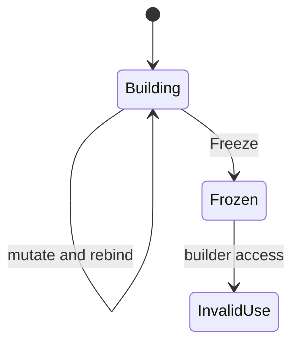

# Locals, loops, and unique builders

A pure function can use local working state. Rebinding a local does not expose a shared mutable object to the caller. A field update on a product returns a new value; see [products](products.md).

```plato
SumTo(n: Integer): Integer {
    var total = 0;
    var i = 0;
    while (i < n) {
        total = total + i;
        i = i + 1;
    }
    return total;
}
```

`var` introduces a local. The local's type is the type of the initializer. Assignment rebinds a variable that `var` already introduced. It does not create a field, and it does not change a record in place. A block creates a local scope. `if (condition) statement else statement` chooses one statement branch. `return` leaves the current function. The checker verifies Boolean conditions and return compatibility. A complete proof that every block path returns a value is not established here. Typed execution of these forms is in the [interpreter](../../../src/Plato.Interpreter/Evaluation/Interpreter.cs).

## Loop forms

`while` is the primitive tested-condition loop. [AstNodeFactory](../../../src/Plato.AST/AstNodeFactory.cs) rewrites a `do` body followed by `while` into one execution of the body and then a while loop. It rewrites `for` into initialization, a condition, a body, and an update. Both rewrites produce the same bound loop representation. An update uses ordinary assignment. `++`, `--`, and compound assignment are unsupported.

```plato
for (var i = 0; i < n; i = i + 1) {
    total = total + i;
}
```

The parser recognizes `foreach`. Its AST translation currently contains an incomplete `MoveNext` placeholder and does not connect the collection expression to iteration. Do not use `foreach` as a library-authoring feature unless an end-to-end fixture passes. Normative prose that treats every loop desugaring as supported is too broad; see [discrepancies](../implementation/discrepancies.md).

There is no supported `break`, `continue`, or `yield`. Write the exit test in the loop condition, return from the function, or use an array combinator. None of these forms guarantees termination.

## Builders

An immutable `Array<T>` is convenient to consume. It cannot expose arbitrary in-place writes without breaking value semantics. The intrinsic builders provide a controlled construction phase:

```plato
RangeValues(n: Integer): Array<Integer> {
    var xs = new List<Integer>();
    var i = 0;
    while (i < n) {
        xs = xs.Add(i);
        i = i + 1;
    }
    return xs.Freeze();
}
```

`List<T>` grows by appending. `Buffer<T>` allocates a fixed number of slots for indexed writes. The `unique` modifier on those declarations records an **affine discipline**: a value should have at most one usable owner. An ordinary user product cannot be declared `unique`. Only these intrinsic builders are accepted.

The builder contract is [primitives.plato](../../../stdlib/foundation/primitives.plato), together with [UniqueTypes](../../../src/Plato.Compiler/Symbols/UniqueTypes.cs), [PlatoList](../../../src/Plato.Intrinsics/PlatoList.cs), [PlatoBuffer](../../../src/Plato.Intrinsics/PlatoBuffer.cs), and the [builder runtime tests](../../../tests/Plato.Intrinsics.Tests/BuilderTests.cs).

## Effect classes

Observe reads a builder, Mutate returns a builder to rebind, and Consume produces the array.

| Class | Members | Authoring rule |
|---|---|---|
| Observe | `Count`, `At` | Read without consuming the builder |
| Mutate | `Add`, `AddRange`, `Set` | Rebind the returned builder or chain the next operation |
| Consume | `Freeze` | Produce immutable array and invalidate the builder |

Rebind a mutating result: `xs = xs.Add(value)`. Do not ignore the builder a mutator returns. Write `Freeze()` with parentheses. Do not store a builder in a product field or inside a generic container, and do not capture a builder in a lambda. For a generic element type, use the declared `EmptyList` convention. `new List<$T>()` is not accepted everywhere.



This discipline is not a proved static ownership system. Lint rules reject some storage shapes, and the runtime checks invalidation after `Freeze`. Aliasing and capture are not comprehensively excluded by a static affine checker. A program that breaks the intended discipline can get farther than a fully linear type system would permit.

[Rust ownership](https://doc.rust-lang.org/book/ch04-01-what-is-ownership.html) also limits aliasing so mutation stays safe. Rust's compile-time borrowing rules are stronger than Plato's present builder checks.

## Grammar

Locals, loops and builders use these rules from [PlatoGrammar.cs](../evidence/grammar-source.md#platogrammarcs):

```text
public Rule WhileStatement => Node(Keyword("while") + AdvanceOnFail + ParenthesizedExpression + Statement);
public Rule ForStatement => Node(Keyword("for") + AdvanceOnFail + Sym("(") + ForLoopInit + EOS +
                                 ForLoopInvariant + EOS + ForLoopVariant + Sym(")") + Statement);
public Rule VarDecl => Node(TypeExpr + ListOfAtLeastOne(VarWithInitialization));
public Rule UniqueKeyword => Node(Keyword("unique"));
```

The grammar accepts `foreach`, `break`, `continue`, `++` and compound assignment. The checked
language does not support them; see [discrepancies](../implementation/discrepancies.md).

## Meaning

A `var` local can be rebound, and an intrinsic builder is updated by rebinding the value
each operation returns. [SEMANTICS section 3](../../SEMANTICS.md) is the authority.

## Common mistake

A beginner writes `i += 1` in a `for` loop, as in C:

```plato
library Build4 {
  Total(n: Integer): Integer {
    var t = 0;
    for (var i = 0; i < n; i += 1) { t = t + i; }
    return t;
  }
  Law_T(): Boolean => Total(4) == 6;
}
```

The language has no compound assignment, but the compiler gives no diagnostic.
`lint --strict` reports no finding, and `run --laws` reports `0 laws`: `Law_T` is not found
in the compiled program. The only symptom is a function that is missing. With the update
written `i = i + 1`, the same program runs `Law_T` and it passes.

`i++` is also accepted without a diagnostic, and a loop that depends on it did not finish in
the interpreter. Treat a missing function or a run that never ends as the sign of an
unsupported update.

A related slip is not reported either: `xs.Add(i);` without rebinding is accepted. Write
`xs = xs.Add(i);` so the program does not depend on how one backend treats the builder.
