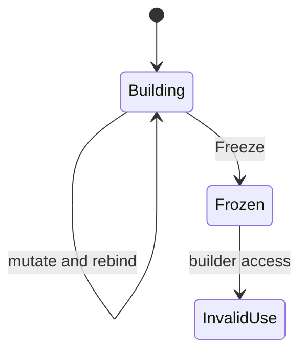

# Locals, loops, and unique builders

Pure functions can use local working state. Changing a local counter does not expose a shared mutable object to callers. Products remain immutable; a field update constructs a new value.

```plato
SumTo(n: Integer): Integer {
    var total = 0;
    var i = 0;
    while (i < n) {
        total = total + i;
        i = i + 1;
    }
    return total;
}
```

`var` introduces a local with the initializer's inferred type. Assignment rebinds an already introduced variable; it does not create a new field or change a record in place. A block creates local scope. An `if (condition) statement else statement` chooses a statement branch. `return` leaves the current function. The checker verifies Boolean conditions and return compatibility, but a complete proof that every block path returns a value is not established here.

## Loop forms

`while` is the primitive tested-condition loop. The AST factory translates a `do` body followed by `while` into one execution of the body and a while loop; it translates `for` into initialization, condition, body, and update. These are syntactic rewrites to the same bound loop representation. Use explicit assignment in updates; `++`, `--`, and compound assignment are unsupported.

```plato
for (var i = 0; i < n; i = i + 1) {
    total = total + i;
}
```

Caution: `foreach` is recognized by the parser, but its AST translation currently contains an incomplete `MoveNext` placeholder and does not connect the collection expression to iteration. Do not use it as a reliable library-authoring feature without a passing end-to-end fixture. The normative prose's blanket inclusion of all loop desugarings is too broad; see [discrepancies](../implementation/discrepancies.md).

There is no supported `break`, `continue`, or `yield`. Express exit conditions in the loop condition, return from the function where appropriate, or prefer array combinators. None of these forms guarantees termination.

## Why builders exist

An immutable `Array<T>` is convenient to consume but cannot expose arbitrary in-place writes without breaking value semantics. The intrinsic builders provide a controlled construction phase:

```plato
RangeValues(n: Integer): Array<Integer> {
    var xs = new List<Integer>();
    var i = 0;
    while (i < n) {
        xs = xs.Add(i);
        i = i + 1;
    }
    return xs.Freeze();
}
```

`List<T>` grows by appending. `Buffer<T>` allocates a fixed number of slots for indexed writes. Their declaration-site `unique` modifier records an **affine discipline**: a value should have at most one usable owner. Ordinary user products cannot be declared unique; only these intrinsic builders are accepted.

## Effect classes

| Class | Members | Authoring rule |
|---|---|---|
| Observe | `Count`, `At` | Read without consuming the builder |
| Mutate | `Add`, `AddRange`, `Set` | Rebind the returned builder or chain the next operation |
| Consume | `Freeze` | Produce immutable array and invalidate the builder |

Use `xs = xs.Add(value)`, not an ignored mutator result. Write `Freeze()` with parentheses. Do not store builders in product fields or inside generic containers; do not capture them in lambdas. For a generic element type, use the declared `EmptyList` convention instead of assuming `new List<$T>()` is accepted everywhere.



The discipline is not a proved static ownership system. Lint rules reject some storage shapes, and runtimes check invalidation after `Freeze`; aliasing and capture are not comprehensively excluded by a static affine checker. A program violating the intended discipline may therefore get farther than a fully linear type system would permit.

## Evidence and related work

The authority is the builder contract in [primitives.plato](../../../stdlib/foundation/primitives.plato), with [UniqueTypes](../../../src/Plato.Compiler/Symbols/UniqueTypes.cs), [PlatoList](../../../src/Plato.Intrinsics/PlatoList.cs), [PlatoBuffer](../../../src/Plato.Intrinsics/PlatoBuffer.cs), and [builder runtime tests](../../../tests/Plato.Intrinsics.Tests/BuilderTests.cs). Loop desugaring lives in [AstNodeFactory](../../../src/Plato.AST/AstNodeFactory.cs); typed execution lives in [Interpreter](../../../src/Plato.Interpreter/Evaluation/Interpreter.cs).

[Rust ownership](https://doc.rust-lang.org/book/ch04-01-what-is-ownership.html) also limits aliasing to make mutation safe, but its compile-time borrowing rules are substantially stronger than Plato's present builder checks. A useful analogy is a laboratory sample container sealed into a final immutable result: construction has state, consumption has a stable value.
