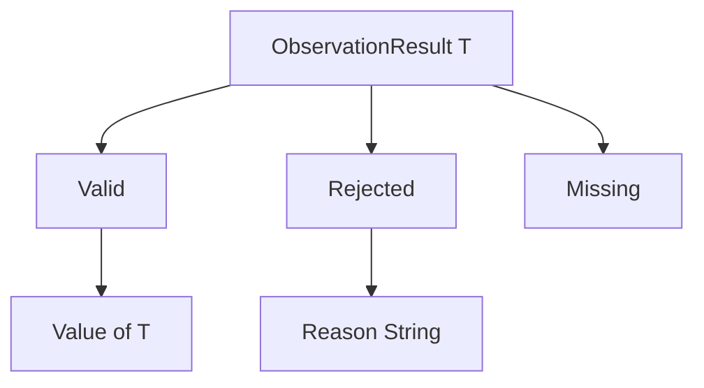

# Sums and exhaustive matching

A **sum type** stores one of several alternatives. A product value has every field.
A sum value is one alternative. Each alternative is a **case** and may carry its
own ordered fields.

```plato
type ObservationResult<T>
    = Valid(Value: T)
    | Rejected(Reason: String)
    | Missing;
```

A value has one active case. `ObservationResult.Valid(x)` builds a payload case.
`ObservationResult.Missing` builds a case with no payload. Context or the payload
infers generic arguments. A bare declaration parameter `T` belongs only inside the
type declaration. A library signature uses `$T`.

[Rust enums](https://doc.rust-lang.org/reference/items/enumerations.html) also
combine alternatives and payloads.

A sum whose cases all lack payloads is the enumeration idiom:

```plato
type Orientation = Clockwise | CounterClockwise;
```

Generic sums are implemented by default. CHK306, the rejection of a generic sum,
remains only as an optional host restriction in
[SumTypeChecker](../../../src/Plato.Compiler/Checking/SumTypeChecker.cs). An AGENTS
statement that sums must be non-generic is stale. See
[discrepancies](../implementation/discrepancies.md). Whether a particular library
wants a generic optional-result vocabulary is a library convention. It is separate
from the compiler's generic-sum capability.

## Matching

```plato
ValueOr(r: ObservationResult<$T>, fallback: $T): $T =>
    match (r) {
        Valid(value) => value;
        Rejected(reason) => fallback;
        Missing => fallback;
    };
```

`match` is an expression and has one result. Its subject has to be a sum. Every
declared case appears exactly once. There is no wildcard arm, default arm, guard,
literal pattern, or nested pattern. A binder is an identifier, in payload order.
The number of binders equals the case's field count, including binders the arm
does not use. Every arm's result has to unify with the result type.

[Rust match](https://doc.rust-lang.org/stable/reference/expressions/match-expr.html)
supports richer patterns than Plato. A Haskell data declaration likewise
distinguishes a product constructor from a sum of constructors. Plato is eager,
and its match checker is a restricted enumeration of the declared cases.

For a nested sum, match the outer sum and write a second match in the relevant
arm. Adding a case makes an old match incomplete. The checker then points at every
consumer that needs a decision.

Let `Cases(S)` be the set of declared cases and `Arms(m)` the list of arm case
names. The match is exhaustive when the list has no duplicates and its set is
`Cases(S)`.

```text
Γ ⊢ subject : S
for each case C(f₀:T₀,...), Γ,x₀:T₀,... ⊢ armC : R
Arms enumerate Cases(S) exactly once
---------------------------------------------------
Γ ⊢ match(subject){arms} : R
```

For `ObservationResult<Integer>.Valid(7)`, the first arm binds `value: Integer`
and returns `7`. For `Missing`, the fallback arm runs. The other arms are not
evaluated.

## Algebra and representation

Ignoring runtime-invalid states, and considering finite payload sets, a product
has as many values as the product of its field cardinalities. A sum has as many
values as the sum of its case payload cardinalities. So
`Maybe<Boolean> = Just(Boolean) | Nothing` has `2 + 1` semantic alternatives.
That counting is what "algebraic data type" means here. It describes the source
model. It is not a formula for the size of the C# storage.



The C# writer emits a tagged readonly struct. A tag selects the active case,
payload fields are flattened, and static factories construct the cases. A generic
sum keeps its generic struct parameters. The elaborator rewrites a match into
conditional tag tests and field projections. A complex match subject may appear in
more than one projection or test in the resulting tree. The implementation does
not insert a dedicated single-evaluation binding. Use a local for an expensive
subject. See [evaluation limits](evaluation.md).

## Errors and evidence

CHK300 means missing cases. CHK301 means an unknown case. CHK302 means a repeated
arm. CHK303 means the wrong binder count. CHK304 means a subject that is not a
sum. CHK305 means a duplicate case declaration. CHK307 means an unsupported
wildcard or default. The sources are
[SumTypeChecker](../../../src/Plato.Compiler/Checking/SumTypeChecker.cs),
[Elaborator](../../../src/Plato.Compiler/Checking/Elaborator.cs), the
[sum emission tests](../../../tests/PlatoTests/Emission/SumTypeCodegenTests.cs),
and the
[generic interpreter tests](../../../tests/Plato.Interpreter.Tests/GenericSumTests.cs).

## Grammar

The sum and `match` productions, copied from [PlatoGrammar.cs](../evidence/grammar-source.md). The `Type` rule that holds `SumTypeBody` is shown in [products](products.md). A match arm starts with an `Identifier`, so a wildcard such as `_` parses; the checker, not the parser, rejects it.

```text
public Rule SumTypeBody => Node(Sym("=") + AdvanceOnFail + CaseDeclaration + (Sym("|") + CaseDeclaration).ZeroOrMore() + EOS);
public Rule CaseDeclaration => Node(Identifier + FunctionParameterList.Optional());
public Rule MatchExpression => Node(Keyword("match") + AdvanceOnFail + ParenthesizedExpression +
                                    Braced(MatchArm.ZeroOrMore(), AdvanceOnFail));
public Rule MatchArm => Node(Identifier + MatchArmBinders.Optional() + Sym("=>") + AdvanceOnFail + Expression + EOS);
public Rule MatchArmBinders => Node(ParenthesizedList(Identifier));
```

## Meaning

A sum value is exactly one of its declared cases, and `match` must name every case once, with one binder per payload field.
There is no default arm. The authority is
[SEMANTICS section 2](../../SEMANTICS.md#sum-types) and
[section 7](../../SEMANTICS.md#7-match).

## Common mistake

The common mistake is to forget a case, or to reach for a wildcard arm as in Rust or C#:

```plato
type Result = Good(Value: Integer) | Bad(Reason: String) | Missing;

library Bad2 {
    Or(r: Result, d: Integer): Integer =>
        match (r) { Good(v) => v; Bad(why) => d; };
}
```

This program is rejected: the match does not list `Missing`. The checker reports CHK300; the message template in
[SumTypeChecker.cs](../../../src/Plato.Compiler/Checking/SumTypeChecker.cs) is:

```text
non-exhaustive match on sum type 'Result': missing case(s) Missing -- add an arm for each (v1 has no default arm)
```

That text is taken from the source, not from a run. The reference command-line tool does not print it: `lint --strict`
and `run --laws` both succeed on this program, and a law that matches `Missing` passes because the last listed arm answers
for the unlisted case. A program that works only by that accident is wrong. This is the most serious gap found in this
pass: the check exists, but the two commands this reference tells readers to run never show it. Use `plato_check`.

Replacing the missing arm with `_ => d` fails differently. It parses, and `run --laws` reports at run time:

```text
error      Bad2.Law_O  case 1:   projection 'Good_Value' on a Result.Missing value (in Or < Law_O)
```

The intended wildcard diagnostic (CHK307) is not shown either. List every case:

```plato
library Good2 {
    Or(r: Result, d: Integer): Integer =>
        match (r) { Good(v) => v; Bad(why) => d; Missing => d; };
}
```
