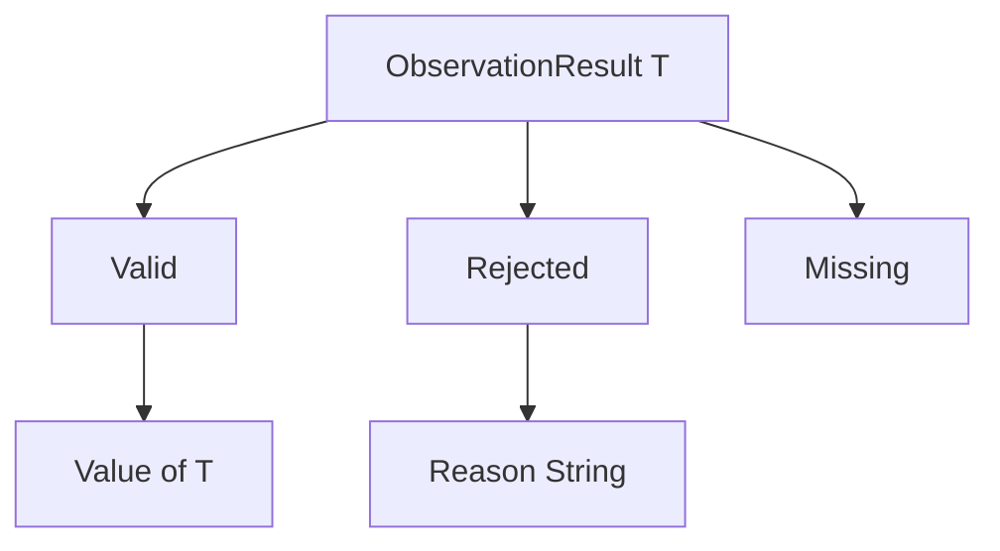

# Sums and exhaustive matching

A **sum type** stores one of several alternatives. A product says “both”; a sum says “one of.” Each alternative is called a **case** and may carry its own ordered fields.

```plato
type ObservationResult<T>
    = Valid(Value: T)
    | Rejected(Reason: String)
    | Missing;
```

A value has one active case. `ObservationResult.Valid(x)` builds a payload case; `ObservationResult.Missing` builds a payload-free case. Context or payload infers generic arguments. Bare declaration parameter `T` belongs only inside the type declaration; library signatures use `$T`.

An all-payload-free sum is the enumeration idiom:

```plato
type Orientation = Clockwise | CounterClockwise;
```

Generic sums are implemented by default. The older rule rejecting them (CHK306) is retained only as an optional host restriction in [SumTypeChecker](../../../src/Plato.Compiler/Checking/SumTypeChecker.cs). An older AGENTS statement that sums must be non-generic is stale; see [discrepancies](../implementation/discrepancies.md). Whether a particular library wants a generic optional-result vocabulary is a separate library convention, not the compiler's generic-sum capability.

## Matching

```plato
ValueOr(r: ObservationResult<$T>, fallback: $T): $T =>
    match (r) {
        Valid(value) => value;
        Rejected(reason) => fallback;
        Missing => fallback;
    };
```

`match` is an expression with one result. Its subject must be a sum. Every declared case appears exactly once. There are no wildcard, default, guard, literal, or nested-pattern arms. Binders are identifiers in payload order, and their number must equal the case's field count even when some are unused. Every arm result must unify with the result type.

For nested sums, match the outer sum and use a second match inside its relevant arm. Adding a case intentionally makes old matches incomplete, so the checker points to every consumer that needs a decision.

Let `Cases(S)` be the set of declared cases and `Arms(m)` the list of arm case names. Exhaustiveness means the list has no duplicates and its set is `Cases(S)`.

```text
Γ ⊢ subject : S
for each case C(f₀:T₀,...), Γ,x₀:T₀,... ⊢ armC : R
Arms enumerate Cases(S) exactly once
---------------------------------------------------
Γ ⊢ match(subject){arms} : R
```

For `ObservationResult<Integer>.Valid(7)`, the first arm binds `value: Integer` and returns `7`. For `Missing`, the fallback arm runs. Other arms are not evaluated.

## Algebra and representation

Ignoring runtime-invalid states and considering finite payload sets, a product has as many values as the product of its field cardinalities; a sum has as many as the sum of its case payload cardinalities. Thus `Maybe<Boolean> = Just(Boolean) | Nothing` has `2 + 1` semantic alternatives. This explains “algebraic data type”; it is an explanation of the source model, not a C# storage-size formula.



The C# writer emits a tagged readonly struct: a tag selects the active case, payload fields are flattened, and static factories construct cases. Generic sums retain generic struct parameters. The elaborator rewrites matches into conditional tag tests and field projections. A complex match subject may appear in more than one projection/test in the resulting tree; the implementation does not insert a dedicated single-evaluation binding here. Use a local for an expensive subject and see [evaluation limits](evaluation.md).

## Errors and evidence

CHK300 means missing cases; CHK301 an unknown case; CHK302 repeated arms; CHK303 wrong binder count; CHK304 a non-sum subject; CHK305 duplicate case declarations; CHK307 unsupported wildcard/default usage. The primary sources are [SumTypeChecker](../../../src/Plato.Compiler/Checking/SumTypeChecker.cs), [Elaborator](../../../src/Plato.Compiler/Checking/Elaborator.cs), [sum emission tests](../../../tests/PlatoTests/Emission/SumTypeCodegenTests.cs), and [generic interpreter tests](../../../tests/Plato.Interpreter.Tests/GenericSumTests.cs).

## Related work

[Rust enums](https://doc.rust-lang.org/reference/items/enumerations.html) also combine alternatives and payloads. [Rust match](https://doc.rust-lang.org/stable/reference/expressions/match-expr.html) supports richer patterns than Plato. Haskell data declarations similarly distinguish product constructors from a sum of constructors, but Plato uses eager evaluation and a restricted enumeration-based match checker.
