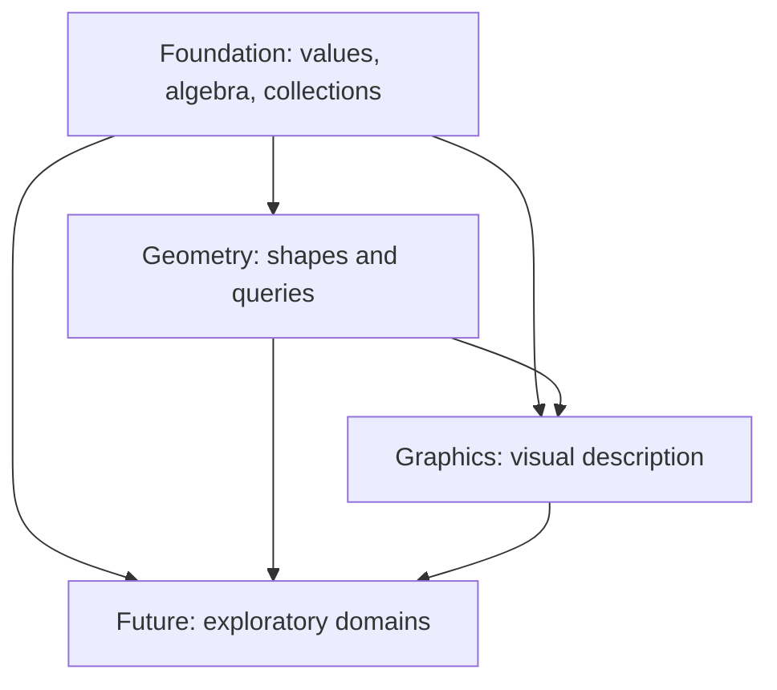

# Standard library

Plato's standard library is a vocabulary of mathematical values and pure functions. A declaration says what a value stores or what an interface requires. A library body says how an operation computes. An intrinsic delegates to the host runtime. None of these, by itself, proves a numerical algorithm correct.

This is a teaching reference. [Global conventions](../../../stdlib/CONVENTIONS.md) remain the authority for units, frames, conversions, and boundaries. The generated API pages reproduce the source, including signatures, formulas, comments, and unresolved notes. Read a guide for the meaning, and the linked API page for the exact overload.

## Reading order

Read the foundation guides in this order:

1. [Scalars and algebra](foundation/scalars-algebra.md)
2. [Collections](foundation/collections.md)
3. [Functions](foundation/functions.md)
4. [Quantities and time](foundation/quantities-time.md)
5. [Angles](foundation/angles.md)
6. [Points and vectors](foundation/points-vectors.md)
7. [Matrices and transforms](foundation/matrices-transforms.md)
8. [Color](foundation/color.md)
9. [Probability](foundation/probability.md)
10. [Statistics](foundation/statistics.md)
11. [Polynomials](foundation/polynomials.md)
12. [Graphs](foundation/graphs.md)

Geometry, graphics, and the aspirational `future` tier come after that vocabulary.

Geometry: [capabilities and primitives](geometry/primitives.md), [curves and splines](geometry/curves.md), [surfaces and differential geometry](geometry/surfaces.md), [meshes and topology](geometry/meshes.md), [polygons and triangulation](geometry/triangulation.md), [solids and BREP](geometry/solids-brep.md), [fields and distance](geometry/fields.md), [sampling and voxels](geometry/sampling-voxels.md), [noise and lattices](geometry/noise-lattices.md), [spatial search and remeshing](geometry/search-remeshing.md).

Graphics: [cameras and lighting](graphics/cameras-lights.md), [images, textures and color spaces](graphics/images-textures.md), [paths, paint and text](graphics/paths-text.md), [time and motion](graphics/motion.md), [scenes and rendering](graphics/scenes-rendering.md).

[Aspirational domains](future/domains.md) are exploratory. [Verification and the legacy boundary](verification-legacy.md) separates a source claim from an executed result.

## Dependencies are directional

An arrow means "may be used by." A shipping tier must not depend on `future`. "Shipping tier" names an inclusion policy. It does not mean that every operation has executed successfully. The law packet in `stdlib/tests` is separate from the tiers.

## Contracts and examples

Mathematical examples in these guides are worked examples. They are not claimed executed tests. A precondition is something the caller must establish. A field comment does not install a runtime validator. Constructing `Probability`, `Direction3D`, a convex polygon, or a watertight solid can assert more than the compiler checks.

When a comment and a body disagree, read the body and its tests, and report the discrepancy. Do not infer the behavior from a familiar name. Generated C# methods use parentheses even where Plato permits member-like notation. Other backend writers are experiments and have no semantic authority here.
