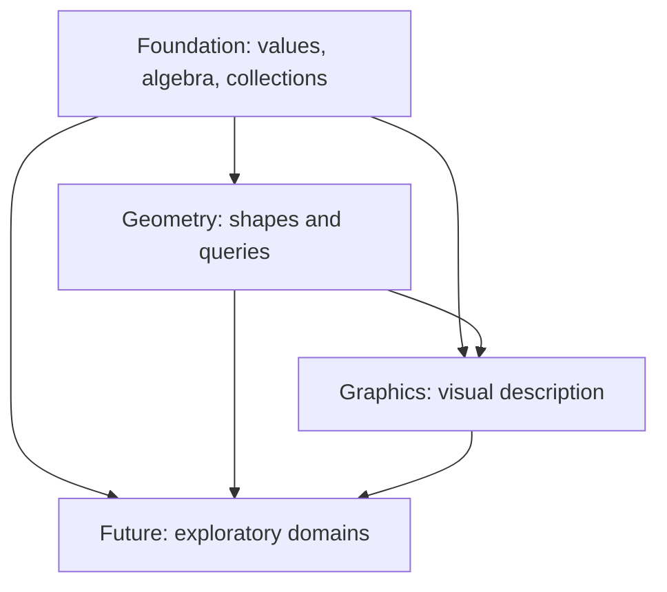

# Standard library

Plato's standard library is a vocabulary of mathematical values and pure functions. A declaration says what a value stores or what an interface requires. A library body says how an operation computes. An intrinsic delegates to the host runtime. None of these, by itself, proves a numerical algorithm correct.

This is a descriptive teaching reference. [Global conventions](../../../stdlib/CONVENTIONS.md) remain the authority for units, frames, conversions and boundaries. The generated API pages reproduce complete source, including individual signatures, formulas, comments and unresolved notes. Read the guide for meaning and the linked API page for the exact overload.

## Reading paths

- Foundation: [scalars and algebra](foundation/scalars-algebra.md), [collections](foundation/collections.md), [functions](foundation/functions.md), [quantities and time](foundation/quantities-time.md), [angles](foundation/angles.md), [points and vectors](foundation/points-vectors.md), [matrices and transforms](foundation/matrices-transforms.md), [color](foundation/color.md), [probability](foundation/probability.md), [statistics](foundation/statistics.md), [polynomials](foundation/polynomials.md), [graphs](foundation/graphs.md).
- Geometry: [capabilities and primitives](geometry/primitives.md), [curves and splines](geometry/curves.md), [surfaces and differential geometry](geometry/surfaces.md), [meshes and topology](geometry/meshes.md), [polygons and triangulation](geometry/triangulation.md), [solids and BREP](geometry/solids-brep.md), [fields and distance](geometry/fields.md), [sampling and voxels](geometry/sampling-voxels.md), [noise and lattices](geometry/noise-lattices.md), [spatial search and remeshing](geometry/search-remeshing.md).
- Graphics: [cameras and lighting](graphics/cameras-lights.md), [images, textures and color spaces](graphics/images-textures.md), [paths, paint and text](graphics/paths-text.md), [time and motion](graphics/motion.md), [scenes and rendering](graphics/scenes-rendering.md).
- Boundaries: [aspirational domains](future/domains.md), [legacy and verification](verification-legacy.md).

## Dependencies are directional

An arrow means “may be used by.” Shipping tiers must never depend on `future`. “Shipping tier” identifies inclusion policy, not a blanket guarantee that every operation has executed successfully. The law packet in `stdlib/tests` is separate from the tiers.

## Contracts, examples and uncertainty

Mathematical examples in these guides are worked examples, not claimed executed tests. A precondition is something the caller must establish; a field comment does not automatically install a runtime validator. In particular, constructing `Probability`, `Direction3D`, a convex polygon or a watertight solid can assert more than the compiler checks.

When comments and bodies disagree, inspect the body and its tests, and report the discrepancy; do not infer behavior from a familiar name. Generated C# methods use parentheses even where Plato permits member-like notation. Other backend writers are experiments and supply no semantic authority here. See [verification](verification-legacy.md) for the distinction between a source claim and an executed result.
