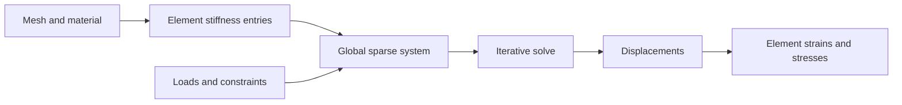

# Engineering materials and finite elements

Read [engineering records](../../api/future/engineering.types.md), [material formulas](../../api/future/engineering-materials.library.md), [finite-element records](../../api/future/finite-elements.types.md) and [finite-element bodies](../../api/future/finite-elements.library.md). These are exploratory numerical models, not certification of an engineering design.

## Material assumptions matter

An isotropic linear-elastic material uses Young's modulus and Poisson's ratio. Derived shear, bulk and Lamé constants use denominators that become singular at limiting ratios. A numerically constructible record need not be a physically admissible material. Stress/strain records also require the stated component convention, especially the distinction between tensor shear strain and engineering shear strain.

`SafetyFactor` is capacity over demand: larger means greater margin. It is not a demand/capacity utilization ratio. Beam loads, section shapes, supports, fits, gears, bearings and weld descriptions each carry domain assumptions; their records do not provide every associated analysis or design-code check.

## The finite-element pipeline

The reference algorithm builds element stiffness from shape-function gradients, assembles a global sparse system, applies displacement/load conditions, solves it, and recovers strain and stress. Linear tetrahedra and triangles and an Euler–Bernoulli beam path are represented in the body file. Plane stress and plane strain are distinct constitutive assumptions.

The sparse coordinate-list representation adds contributions with duplicate row/column coordinates. Concatenating element entry arrays is therefore valid assembly only because lookup/product semantics sum duplicates. Do not replace that representation with a last-write-wins map.

The solver uses constrained conjugate gradients, which needs the relevant positive-definiteness assumptions. Missing supports can leave rigid-body modes and a singular system. Degenerate cells invalidate gradient/volume calculations. A residual/termination result must be inspected before interpreting displacements; producing a vector is not proof of convergence or model suitability. Refining a mesh and checking numerical convergence is separate from successfully compiling the solver.

## Related work

[DOLFINx's elasticity demonstration](https://docs.fenicsproject.org/dolfinx/main/python/demos/demo_elasticity.html) also assembles and solves a linear-elastic problem, using a finite-element framework and algebraic multigrid support. Plato's explicit element formulas, coordinate-list assembly and constrained conjugate-gradient body are a different implementation with their own convergence obligations. [JCGM's measurement guides](https://www.bipm.org/en/committees/jc/jcgm/publications) address uncertainty in inputs/results; a deterministic finite-element answer does not remove material, measurement or modeling uncertainty.
