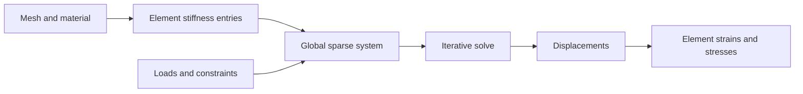

# Engineering materials and finite elements

This vocabulary is in the `future` tier, which is not part of the default library. The records are exploratory numerical models. They do not certify an engineering design.

## Elastic constants and safety factor

An isotropic linear-elastic material stores Young's modulus and Poisson's ratio. The derived shear, bulk, and Lamé constants divide by expressions that vanish at limiting ratios. A record you can construct is not necessarily a physically admissible material. Stress and strain records also need the stated component convention, in particular the difference between tensor shear strain and engineering shear strain.

`SafetyFactor` is capacity over demand. A larger value is a larger margin. It is not a demand-over-capacity utilization ratio. Beam loads, section shapes, supports, fits, gears, bearings, and weld descriptions each carry domain assumptions. The records do not include every associated analysis or design-code check.

## The finite-element pipeline

The reference algorithm builds element stiffness from shape-function gradients, assembles a global sparse system, applies displacement and load conditions, solves the system, and recovers strain and stress. The body file includes linear tetrahedra, linear triangles, and an Euler-Bernoulli beam path. Plane stress and plane strain are different constitutive assumptions.

The sparse coordinate list adds contributions that may repeat a row and column. Concatenating element entry arrays is valid assembly because lookup and products sum those duplicates. A last-write-wins map is a different operation.

The solver is a constrained conjugate gradient, which needs the relevant positive-definiteness assumptions. Missing supports can leave rigid-body modes and a singular system. A degenerate cell invalidates the gradient and volume calculations. Read the residual or termination result before interpreting displacements. A returned vector is not proof of convergence or of a suitable model. Checking convergence by refining the mesh is separate from compiling the solver.

## Where to look

- [Engineering records](../../api/future/engineering.types.md) and [material formulas](../../api/future/engineering-materials.library.md)
- [Finite-element records](../../api/future/finite-elements.types.md) and [finite-element bodies](../../api/future/finite-elements.library.md)
- [Aspirational library domains](domains.md)

[DOLFINx's elasticity demonstration](https://docs.fenicsproject.org/dolfinx/main/python/demos/demo_elasticity.html) assembles and solves a linear-elastic problem in a finite-element framework. The element formulas, coordinate-list assembly, and constrained conjugate-gradient body here are a different implementation, with their own convergence obligations. [JCGM's measurement guides](https://www.bipm.org/en/committees/jc/jcgm/publications) cover uncertainty in inputs and results. A deterministic finite-element answer does not remove material, measurement, or modeling uncertainty.
