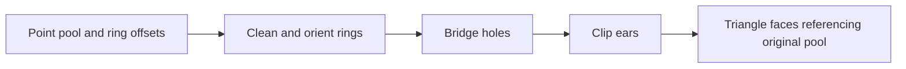

# Polygons, holes and triangulation

A polygon ring is a boundary, usually with an implied edge from the last vertex back to the first. A polyline is a path and does not have to close. `ConvexPolygon2D` asserts convexity. An array of points does not.

Self-intersections, repeated edges, a hole outside the outer ring, and holes that cross each other need an explicit check, or they sit outside an algorithm's preconditions.

## Rings and signed area

Signed planar area is the shoelace sum. For vertices `(xi, yi)` and the cyclic next index `j`, twice the signed area is `sum(xi*yj - xj*yi)`. Counterclockwise order gives a positive area. Absolute area drops the orientation, so it cannot stand in for a winding check.

## The triangulator keeps the point pool

The triangulator uses one shared point pool and ring boundaries. Ring zero is the outer boundary. Hole-start offsets divide the remaining rings. Each output `TriangleFace` indexes that original pool, so a source vertex keeps its identity through the decomposition.

Before ear clipping, the outer ring is made counterclockwise and the holes clockwise. Hole bridging builds a walk the clipper can use. Its coincidence checks are exact. A bridge vertex you duplicated on purpose must not merge with a nearby distinct point under a global epsilon. A ring that cleanup reduces below three vertices encloses nothing, and it is dropped.

## The laws do not accept every point array

A random point array is often self-intersecting, so a randomized law over all arrays cannot assume a valid polygon. The triangulation laws and the dedicated harness separate unrestricted algebraic laws from fixtures with well-formed input. This guide does not claim those tests were run while the page was written.

The polygon library's convex support-query TODO is about a faster search over the ring. Cost, numerical robustness, and output winding are separate properties. A triangulation can satisfy one of them and fail another.

## Where to look

- [Polygon records](../../api/geometry/polygons.types.md) and [polygon operations](../../api/geometry/polygons.library.md)
- [Planar shapes](../../api/geometry/planar.types.md)
- [Triangulation bodies](../../api/geometry/triangulation.library.md) and [ear-clip nodes](../../api/geometry/triangulation.types.md)
- [Triangulation laws](../../../../stdlib/tests/triangulation.laws.plato) and the [dedicated harness](../../../../tests/Plato.Triangulation.Tests)

[CGAL's triangulation packages](https://doc.cgal.org/latest/Manual/packages.html) include more than one triangulation model. Ear clipping with hole bridging is not constrained Delaunay triangulation, and it does not promise that model's angle quality or robust predicates. Pick the algorithm by the output property you need, not by the word "triangulate."
