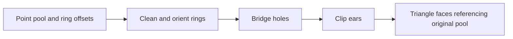

# Polygons, holes and triangulation

Read [polygon records](../../api/geometry/polygons.types.md), [polygon operations](../../api/geometry/polygons.library.md), [planar shapes](../../api/geometry/planar.types.md), [triangulation bodies](../../api/geometry/triangulation.library.md), and [ear-clip nodes](../../api/geometry/triangulation.types.md).

## A polygon is more than an array

A polygon ring describes a boundary, usually with an implied closing edge from the last vertex to the first. A polyline describes a path and need not close. A `ConvexPolygon2D` asserts convexity; arbitrary points in an array do not prove it. Self-intersections, repeated edges, holes outside the outer ring and intersecting holes require explicit validation or are outside an algorithm's preconditions.

Signed planar area uses the shoelace sum. For vertices `(xi,yi)` and cyclic next index `j`, twice the signed area is `sum(xi*yj-xj*yi)`. CCW order gives positive area. Absolute area discards orientation and cannot replace a winding check.

## Preserve the point pool

The triangulator works with a shared point pool and ring boundaries. Ring zero is the outer boundary; hole-start offsets divide the remaining rings. Output `TriangleFace` references index that original pool, so source vertex identity survives the decomposition.

Before ear clipping, it makes the outer ring CCW and holes clockwise. Hole bridging builds a walk suitable for clipping. Its coincidence checks are exact; deliberately duplicated bridge vertices must not accidentally merge with nearby distinct points under a global epsilon. Rings reduced below three vertices after cleanup enclose nothing and are dropped.

## Preconditions remain a separate problem

A random point array is often self-intersecting, so randomized laws over all arrays cannot assume a valid polygon. Read [triangulation laws](../../../../stdlib/tests/triangulation.laws.plato) and the [dedicated harness](../../../../tests/Plato.Triangulation.Tests) for the distinction between unrestricted algebraic laws and well-formed input fixtures. This guide does not claim those tests were run during documentation authoring.

The polygon library's convex support-query TODO concerns a faster search over the ring. Algorithmic cost, numerical robustness and output winding are separate properties; a triangulation can satisfy one while failing another.

## Related work

[CGAL's triangulation packages](https://doc.cgal.org/latest/Manual/packages.html) include multiple triangulation models. Plato's ear clipping with hole bridging is not automatically constrained Delaunay triangulation and does not promise its angle-quality or robust-predicate properties. Choose the algorithm by required output properties, not the generic word “triangulate.”
